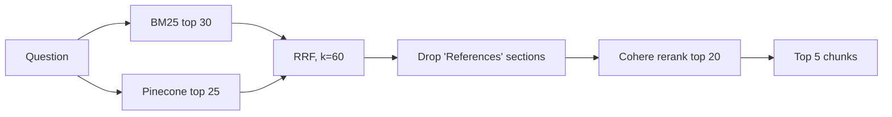

# WSTG Intelligence: Hybrid RAG Retrieval over OWASP WSTG

Retrieval pipeline over the [OWASP Web Security Testing Guide](https://github.com/OWASP/wstg) combining BM25, Pinecone vector search, Reciprocal Rank Fusion (RRF) and Cohere reranking, with an offline evaluation harness on **113 questions**.

## Final Results

Averages over **113 questions in 12 category datasets, K = 5** (best per metric in bold).

| Method | Norm. Precision@5 | Recall@5 | MRR@5 | MAP@5 | NDCG@5 |
|---|:---:|:---:|:---:|:---:|:---:|
| Pinecone vector | **0.8558** | **0.8551** | 0.7990 | 0.7935 | 0.8108 |
| BM25 + vector + RRF | 0.8392 | 0.8384 | 0.8144 | 0.8097 | 0.8184 |
| BM25 + vector + RRF + Cohere | **0.8558** | **0.8551** | **0.8454** | **0.8374** | **0.8436** |

Full-precision values: [`average_metrics_normalized_12_datasets.csv`](average_metrics_normalized_12_datasets.csv). Each dataset is evaluated separately and the 12 results are averaged with equal weight.

Cohere reranking gives the best ranking quality (MRR, MAP, NDCG) while matching Pinecone on precision and recall, since it reorders the same candidates.

## Pipeline Overview



## Models and Configuration

| Component | Choice |
|---|---|
| Embeddings | `BAAI/bge-base-en-v1.5` (768-dim, local, CPU) |
| Vector store | Pinecone (`wstg-intelligence`, namespace `wstg-v1`) |
| Keyword search | BM25Okapi (`rank_bm25`) |
| Fusion | RRF, `RRF_K = 60` |
| Reranker | Cohere `rerank-v3.5` |
| Retrieval sizes | `k=5`, `bm25_k=30`, `vector_k=25`, `candidate_k=20` |

## Chunking Strategy

Structure-aware: split by Markdown headings (h1 to h4), then split oversized sections by token count.

| Setting | Value |
|---|---|
| Chunk size | **350 tokens** |
| Chunk overlap | **50 tokens** |
| Token counting | `BAAI/bge-base-en-v1.5` tokenizer (model limit 512) |

Each chunk keeps `source`, `filename` and a `heading_path`. The title/ID block is merged with the first section so test IDs stay with content.

## Evaluation Methodology

1. **Collect:** run every question through four configurations (BM25, Pinecone, BM25 + vector + RRF, + Cohere) and save the top-5 chunks.
2. **Evaluate:** score the saved rankings offline against each question's `relevant_sources`. No retrieval calls are made.

- Relevance is judged at **source-file level**, and repeated chunks from one file count once.
- Metrics are computed per question, then averaged. BM25 is evaluated as a baseline but not shown in the table above.

| Metric | Definition |
|---|---|
| Normalized Precision@K | relevant in top K / min(\|R\|, K) |
| Recall@K | relevant in top K / \|R\| |
| MRR@K | 1 / rank of first relevant source |
| MAP@K | Average Precision, divided by min(\|R\|, K) |
| NDCG@K | Binary relevance, log₂ discount |

`R` is the set of relevant sources for a question. Normalized precision is used because raw Precision@5 is capped at 0.2 when a question has one relevant source.

## Setup

```bash
pip install python-dotenv rank-bm25 cohere transformers \
    langchain-core langchain-huggingface langchain-pinecone langchain-text-splitters
```

Create a `.env` file (Pinecone index must exist with 768 dimensions):

```env
PINECONE_API_KEY=your_pinecone_key
COHERE_API_KEY=your_cohere_key
```

Optional overrides: `EMBEDDING_MODEL`, `PINECONE_INDEX_NAME`, `PINECONE_NAMESPACE`, `COHERE_RERANK_MODEL`, `WSTG_REPO_PATH`.

Build the chunk corpus and vector index:

```bash
python ingest.py
```

## Running the Evaluation

Replace `<dataset_path>` and `<output_dir>` with the relevant paths for each evaluation dataset.

**1. Collect retrieval results**

```bash
python collect_retrieval_results.py --dataset <dataset_path> --output-dir <output_dir>
```

**2. Evaluate retrieval metrics**

```bash
python evaluate_retrieval_results.py --dataset <dataset_path> --retrieval-dir <output_dir> --output-dir <output_dir>/evaluation
```

**Example** for `wstg_injection_testing_eval_20.json`:

```bash
python collect_retrieval_results.py --dataset data/wstg_injection_testing_eval_20.json --output-dir retrieval_experiments/injection_testing
```

```bash
python evaluate_retrieval_results.py --dataset data/wstg_injection_testing_eval_20.json --retrieval-dir retrieval_experiments/injection_testing --output-dir retrieval_experiments/injection_testing/evaluation
```

**Execution order:** run the collection command first, followed by the evaluation command. The first generates retrieval results for the configured methods; the second calculates Normalized Precision@K, Recall@K, MRR@K, MAP@K, and NDCG@K.

Use `--resume` on the collection command to continue an interrupted run.

## Project Structure

```
├── ingest.py                      # chunk WSTG, save JSONL, index in Pinecone
├── hybrid_retriever.py            # BM25 + Pinecone + RRF + Cohere
├── reranker.py                    # Cohere rerank (throttle, retry, fallback)
├── utils.py                       # chunk key for fusion/caching
├── collect_retrieval_results.py   # Part A: save ranked results
├── evaluate_retrieval_results.py  # Part B: compute metrics
├── average_metrics_normalized_12_datasets.csv
└── data/                          # wstg_chunks.jsonl + evaluation datasets
```

## Notes and Limitations

- Relevance labels are at file level, so the evaluation checks whether the right page is found, not the best passage.
- Averages are equal-weighted across datasets, not across the 113 questions.
- If Cohere fails for a query, the pipeline falls back to RRF order and the evaluation prints a warning.
