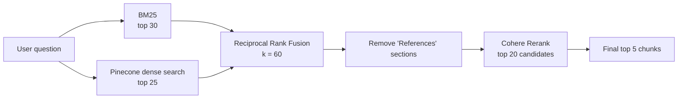

# WSTG Intelligence: Hybrid RAG Retrieval over the OWASP Web Security Testing Guide

A retrieval pipeline over the [OWASP Web Security Testing Guide (WSTG)](https://github.com/OWASP/wstg) that combines keyword search (BM25), dense vector search (Pinecone), Reciprocal Rank Fusion (RRF) and Cohere reranking. The repository also contains a reproducible, offline evaluation harness that scores retrieval on **113 evaluation questions** using Normalized Precision@K, Recall@K, MRR@K, MAP@K and NDCG@K.

---

## Table of Contents

1. [Evaluation Methodology](#evaluation-methodology)
2. [Chunking Strategy](#chunking-strategy)
3. [Final Results](#final-results)
4. [Pipeline Overview](#pipeline-overview)
5. [Models and Configuration](#models-and-configuration)
6. [Setup](#setup)
7. [Running the Evaluation](#running-the-evaluation)
8. [Project Structure](#project-structure)
9. [Notes and Limitations](#notes-and-limitations)

---

## Evaluation Methodology

### Overall workflow

```
Evaluation dataset (questions, reference answers, relevant_sources)
        │
        ▼
Part A: collect_retrieval_results.py
   Runs each question through the retrieval configurations
   and saves the top-5 chunks per method (JSON, with a run manifest)
        │
        ▼
Part B: evaluate_retrieval_results.py
   Reads the saved rankings (no retrieval calls) and computes metrics
        │
        ▼
Per-method JSON reports + comparison.csv
```

Separating collection from scoring means metrics can be recomputed or changed without calling Pinecone or Cohere again. Collection checkpoints after every question and supports `--resume`; the manifest stores a SHA-256 hash of the dataset and all retrieval settings so a resumed run is guaranteed to be compatible.

### Configurations

1. **BM25**: keyword retrieval only. It is the keyword component of the hybrid and is not included in the final results table.
2. **Pinecone vector**: dense retrieval only.
3. **BM25 + vector + RRF**: hybrid retrieval with Reciprocal Rank Fusion.
4. **BM25 + vector + RRF + Cohere**: hybrid retrieval followed by Cohere reranking.

The reference-section filter is applied to all configurations so they are compared on equal terms.

### Evaluation dataset format

Each dataset is a JSON file with `k`, `relevance_unit` (`source`) and a list of `queries`. Every query has an `id`, `wstg_id`, `question`, `reference_answer` and `relevant_sources` (exact WSTG Markdown filenames).

```json
{
  "id": "WSTG-MIX-EVAL-031",
  "wstg_id": "WSTG-ERRH-01",
  "question": "How can a tester identify improper error handling ...?",
  "reference_answer": "...",
  "relevant_sources": ["01-Testing_For_Improper_Error_Handling.md"]
}
```

The full evaluation set contains **113 questions in 12 category datasets**.

### Relevance and ranking rules

- **Relevance is judged at source-file level.** A retrieved chunk counts as relevant if its source file is listed in the question's `relevant_sources`.
- Source paths are normalized to the bare filename before comparison.
- **Repeated chunks from the same file count once**, keeping the position of the first occurrence, so several chunks from one relevant file cannot inflate any metric.
- Only the top K = 5 retrieved chunks per method are evaluated.

### Metric definitions

Let `ranked` be the de-duplicated list of retrieved sources, `R` the set of relevant sources for the question, and `K = 5`.

| Metric | Per-question definition |
|---|---|
| **Normalized Precision@K** | (relevant sources in top K) / min(\|R\|, K), i.e. standard Precision@K divided by the highest Precision@K that question could achieve |
| **Recall@K** | (relevant sources in top K) / \|R\| |
| **MRR@K** | 1 / rank of the first relevant source in top K (0 if none) |
| **MAP@K** | Average Precision: sum of Precision at each rank where a relevant source appears, divided by min(\|R\|, K) |
| **NDCG@K** | DCG / IDCG with binary relevance (1 if relevant, else 0), gain discounted by log₂(rank + 1); IDCG assumes min(\|R\|, K) relevant results ranked first |

Standard Precision@K divides by K, so a question with a single relevant source can never score above 1/5 = 0.2 at K = 5. Normalizing by min(\|R\|, K) puts every question on a 0 to 1 scale. MAP uses the same min(\|R\|, K) denominator, so relevant sources that are not found in the top K lower the score.

### Aggregation

Each metric is calculated per question and then averaged (macro-average) across the questions in a dataset. Results are rounded to six decimals. The final table averages the 12 dataset-level results for each method and metric with equal weight.

---

## Chunking Strategy

Chunking is structure-aware because each WSTG page is a test case with headings such as Summary, Test Objectives, How to Test and Remediation.

| Setting | Value |
|---|---|
| Chunk size | **350 tokens** |
| Chunk overlap | **50 tokens** |
| Length measurement | Tokens, using the `BAAI/bge-base-en-v1.5` tokenizer (the model accepts at most 512 tokens, so 350 leaves headroom) |
| Heading split levels | `#`, `##`, `###`, `####` (headers are kept in the chunk text) |
| Secondary splitter | `RecursiveCharacterTextSplitter` with separators `"\n\n"`, `"\n"`, `"."`, `" "`, `""` |

Process:

1. Each Markdown file is split by heading levels 1 to 4.
2. A very short opening block that contains only the page title and test ID (under 50 tokens) is merged with the section that follows it, so the ID stays attached to real content.
3. Sections larger than 350 tokens are split further with a 50-token overlap.
4. Every chunk carries `source` (relative file path), `filename`, and a readable `heading_path` such as `Testing for X > How to Test > Black-Box Testing`.

Chunks are saved to `data/wstg_chunks.jsonl` (used by BM25) and uploaded to Pinecone (used for dense retrieval).

---

## Final Results

Final average retrieval metrics over the full evaluation set (**113 questions across 12 category datasets, K = 5**). Best value per metric is in **bold**.

| Method | Normalized Precision@5 | Recall@5 | MRR@5 | MAP@5 | NDCG@5 |
|---|:---:|:---:|:---:|:---:|:---:|
| Pinecone vector | **0.8558** | **0.8551** | 0.7990 | 0.7935 | 0.8108 |
| BM25 + vector + RRF | 0.8392 | 0.8384 | 0.8144 | 0.8097 | 0.8184 |
| BM25 + vector + RRF + Cohere | **0.8558** | **0.8551** | **0.8454** | **0.8374** | **0.8436** |

The six-decimal values are in [`average_metrics_normalized_12_datasets.csv`](average_metrics_normalized_12_datasets.csv).

**Reading the table**

- **Hybrid RRF + Cohere reranking is best on every rank-aware metric** (MRR, MAP, NDCG). Compared with RRF alone, MRR improves from 0.8144 to 0.8454 and NDCG from 0.8184 to 0.8436; compared with Pinecone vector search alone, MRR improves from 0.7990 to 0.8454.
- Normalized precision and recall are tied between Pinecone vector search and the full pipeline. Reranking reorders the same candidate pool, so it changes *where* relevant sources appear rather than *whether* they are retrieved.
- RRF on its own improves ranking quality (MRR/MAP/NDCG) over Pinecone vector search, but its recall (0.8384) is slightly below Pinecone vector search alone (0.8551).
- Normalized precision is nearly identical to recall. The two formulas only differ for questions that have more relevant sources than K, which is rare in this dataset.

**How the averages were computed:** each of the 12 evaluation datasets was evaluated separately with the evaluation script, and the final figures are the unweighted (macro) arithmetic mean of the 12 dataset-level results for each method and metric. Every dataset therefore contributes equally, regardless of how many questions it contains.

---

## Pipeline Overview



1. **BM25** retrieves chunks by keyword match, which is useful for exact technical terms and WSTG test IDs.
2. **Pinecone vector search** retrieves chunks by semantic similarity using locally computed embeddings.
3. **RRF** fuses the two ranked lists using rank positions only: `score = Σ 1 / (60 + rank)`.
4. Chunks from any heading path named `References` are removed, because they add noise without testing guidance.
5. **Cohere rerank** rescores the top 20 fused candidates against the query and returns the top 5.

---

## Models and Configuration

| Component | Choice |
|---|---|
| Embedding model | `BAAI/bge-base-en-v1.5` (768-dimensional, run locally on CPU, embeddings normalized) |
| Vector database | Pinecone, index `wstg-intelligence`, namespace `wstg-v1` |
| Keyword retrieval | BM25Okapi (`rank_bm25`), lowercase `\b\w+\b` tokenization |
| Fusion | Reciprocal Rank Fusion, `RRF_K = 60` |
| Reranker | Cohere Rerank, model `rerank-v3.5` (override with `COHERE_RERANK_MODEL`) |
| Orchestration / loaders | LangChain (`langchain-core`, `langchain-huggingface`, `langchain-pinecone`, `langchain-text-splitters`) |
| Tokenizer for chunk sizing | Tokenizer of `BAAI/bge-base-en-v1.5` |

**Retrieval parameters**

| Parameter | Value | Meaning |
|---|---|---|
| `k` | 5 | Final number of chunks returned and evaluated |
| `bm25_k` | 30 | BM25 candidates fed to fusion |
| `vector_k` | 25 | Dense candidates fed to fusion |
| `candidate_k` | 20 | Fused candidates sent to the Cohere reranker |
| `RRF_K` | 60 | RRF smoothing constant |

The reranker call is throttled to one request per 6.5 seconds, retries on HTTP 429, caches results per query/candidate set, and falls back to the RRF order if the API fails. Fallbacks are recorded in the saved results and flagged in the evaluation output.

---

## Setup

**Requirements:** Python 3.9 or newer, a Pinecone account (with an index created for 768-dimensional vectors) and a Cohere API key.

```bash
pip install python-dotenv rank-bm25 cohere transformers \
    langchain-core langchain-huggingface langchain-pinecone langchain-text-splitters
```

Clone the WSTG repository, then create a `.env` file:

```env
PINECONE_API_KEY=your_pinecone_key
COHERE_API_KEY=your_cohere_key

# Optional overrides (defaults shown)
EMBEDDING_MODEL=BAAI/bge-base-en-v1.5
PINECONE_INDEX_NAME=wstg-intelligence
PINECONE_NAMESPACE=wstg-v1
COHERE_RERANK_MODEL=rerank-v3.5
WSTG_REPO_PATH=./wstg/document/4-Web_Application_Security_Testing
```

Build the corpus and the vector index (writes `data/wstg_chunks.jsonl` and uploads vectors to Pinecone):

```bash
python ingest.py
```

---

## Running the Evaluation

Replace `<dataset_path>` and `<output_dir>` with the relevant paths for each evaluation dataset.

**1. Collect retrieval results**

```bash
python collect_retrieval_results.py --dataset <dataset_path> --output-dir <output_dir>
```

**2. Evaluate retrieval metrics**

```bash
python evaluate_retrieval_results.py --dataset <dataset_path> --retrieval-dir <output_dir> --output-dir <output_dir>/evaluation
```

### Example

For `wstg_injection_testing_eval_20.json`:

```bash
python collect_retrieval_results.py --dataset data/wstg_injection_testing_eval_20.json --output-dir retrieval_experiments/injection_testing
```

```bash
python evaluate_retrieval_results.py --dataset data/wstg_injection_testing_eval_20.json --retrieval-dir retrieval_experiments/injection_testing --output-dir retrieval_experiments/injection_testing/evaluation
```

**Execution order:** run the collection command first, followed by the evaluation command. The first generates retrieval results for the configured methods; the second calculates Normalized Precision@K, Recall@K, MRR@K, MAP@K, and NDCG@K.

### Outputs

| File | Contents |
|---|---|
| `<output_dir>/run_manifest.json` | Dataset hash, retrieval settings, models, timestamps |
| `<output_dir>/<method>_retrieval.json` | Top-5 chunks per question for each method |
| `<output_dir>/evaluation/comparison.csv` | Aggregate metrics for the compared methods |
| `<output_dir>/evaluation/comparison_report.json` | Full comparison with settings and per-method reports |
| `<output_dir>/evaluation/<method>_evaluation.json` | Per-question metrics, retrieved vs. relevant sources |

Optional flags for collection: `--k`, `--bm25-k`, `--vector-k`, `--candidate-k`, and `--resume` to continue an interrupted run. If Cohere falls back to RRF order for any question, both scripts print a warning; recollect before drawing conclusions about reranking quality.

---

## Project Structure

```
.
├── ingest.py                                   # Load WSTG Markdown, chunk, save JSONL, index in Pinecone
├── hybrid_retriever.py                         # BM25 + Pinecone + RRF + Cohere (retrieve_stages / hybrid_retrieve)
├── reranker.py                                 # Cohere rerank with throttling, retry, cache and fallback
├── utils.py                                    # Stable chunk key used for fusion and caching
├── collect_retrieval_results.py                # Part A: collect and save ranked results per method
├── evaluate_retrieval_results.py               # Part B: compute metrics from saved results
├── average_metrics_normalized_12_datasets.csv  # Final averaged metrics across the 12 datasets
└── data/
    ├── wstg_chunks.jsonl                       # Saved chunk corpus (generated by ingest.py)
    └── *.json                                  # Evaluation datasets
```

---

## Notes and Limitations

- **Why normalized precision.** Standard Precision@5 is capped at 0.2 when a question has a single relevant source, which made raw values look low even for perfect retrieval. Normalized precision rescales each question to 0 to 1, but because it equals recall whenever a question has K or fewer relevant sources, recall, MRR, MAP and NDCG carry the most information here.
- **Source-level relevance.** Labels identify relevant WSTG files, not specific chunks, so the evaluation measures whether the right page is retrieved, not whether the exact best passage is.
- **Equal-weighted averages.** The final table averages dataset-level results equally. A question-weighted average over all 113 questions would differ slightly if the datasets have different sizes.
- **Single reranker run.** Results come from one collection run per dataset; Cohere API behavior can vary between runs.
- Questions and reference answers in the datasets were generated from the WSTG Markdown files, and relevant sources are exact filenames from that corpus.
